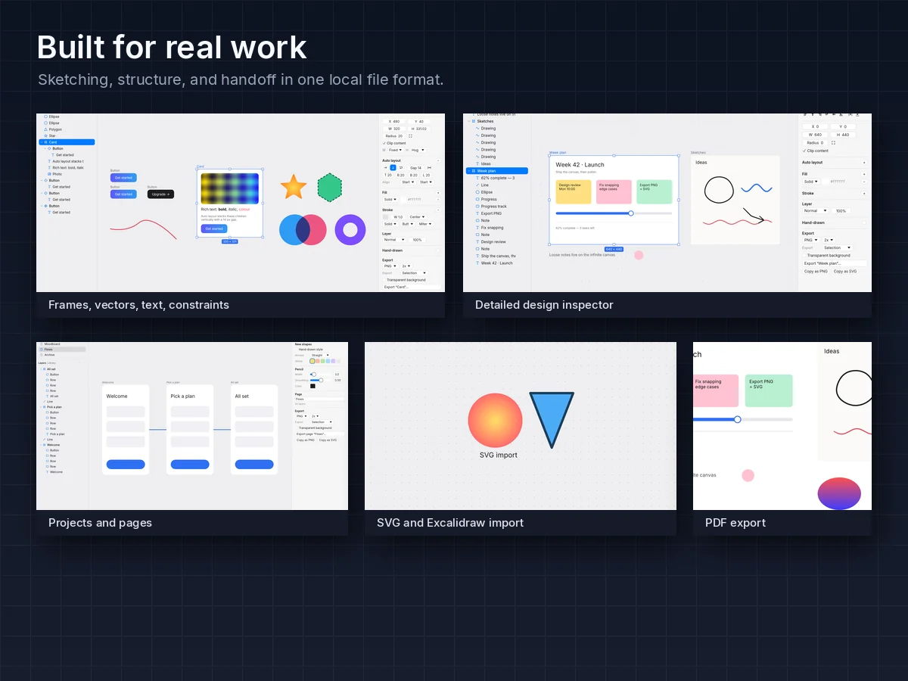

# drawio-rs


[](LICENSE)
[](#get-started)

drawio-rs is a native infinite canvas for diagrams, whiteboards and vector sketches. Your work stays in a folder on your computer. There is no account, no cloud sync and no browser tab to keep open.

Use it for system diagrams, brainstorm boards, UI sketches or a quick drawing you want to keep editable. Shapes stay as shapes, arrows follow the nodes they connect and the canvas keeps going in every direction.



## What you can do

- Draw frames, shapes, freehand paths, sticky notes and text.
- Connect shapes with arrows that reroute when you move either end.
- Switch to whiteboard mode for rough strokes, a laser pointer and a shape library.
- Edit vectors with booleans, corners and snapping.
- Work across pages and keep a separate undo history for each one.
- Search for nodes, then edit their styles, labels, tags and links in the right panel.
- Import SVG, Excalidraw and draw.io diagrams. Export back to draw.io XML.
- Export PNG, SVG and PDF, including single frames at 1x or 2x.
- Drive the running app from an MCP client when you want scripts to draw for you.

## Get started

You need Rust 1.95 or newer. Install it with [rustup](https://rustup.rs), then build and run the app:

```sh
cargo build --release
./target/release/drawio-rs                  # projects home screen
./target/release/drawio-rs --demo           # sample board, not saved
./target/release/drawio-rs ~/Documents/drawio-rs/Plan   # open a project
./target/release/drawio-rs board.drawio-rs  # open a drawio-rs document
```

On macOS the release build uses Metal. On Linux it uses Vulkan through wgpu. Shortcuts use `Cmd` on macOS and `Ctrl` elsewhere.

A first-run tour shows the three basic moves: draw a shape, connect two shapes and export the result. Press `/` any time to see the full shortcut list. Press `Escape` to close the tour.

## Your files

Each project is a folder, and each page is a JSON file.

```text
~/Documents/drawio-rs/<project>/
  project.json
  pages/
    650eff920501e1d1.json
```

drawio-rs writes through a temporary file before it replaces a page, so a crash should not leave a half-written document. Set `DRAWIO_RS_HOME` if you want projects somewhere else.

drawio-rs moves `~/Documents/paper-rs` to `~/Documents/drawio-rs` on first launch. It still opens `.paper-rs` documents and the old `PAPER_RS_*` environment variables.

## Controls

| Action | macOS | Linux |
| --- | --- | --- |
| Select | `V` | `V` |
| Hand / pan | `H` or space drag | `H` or space drag |
| Rectangle | `R` | `R` |
| Ellipse | `O` | `O` |
| Text | `T` | `T` |
| Connector | `C` | `C` |
| Sticky note | `S` | `S` |
| Duplicate | `Cmd D` | `Ctrl D` |
| Delete | `Delete` | `Delete` |
| Undo / redo | `Cmd Z` / `Cmd Shift Z` | `Ctrl Z` / `Ctrl Shift Z` |
| Zoom to fit | `Shift 1` | `Shift 1` |

Trackpad pinch zooms on macOS. Middle drag and space drag pan everywhere.

## Import, export and automation

The right panel handles PNG, SVG, PDF and draw.io exports. Frames export at 1x or 2x. The command line can also export a page without opening the window.

For scripted work, build the optional MCP bridge and point an MCP client at the running app:

```sh
cargo build --release --bin drawio-rs-mcp
```

Set `DRAWIO_RS_MCP_PORT` before starting drawio-rs. The bridge talks over localhost and exposes tools for selection, creation, styling, search, export and page navigation. See `src/mcp/tools.rs` for the current tool list.

## Project background

drawio-rs is a clean-room reimplementation modeled on Paper Desktop. `analysis/PAPER_ARCHITECTURE.md` records what that app does, based on a licensed copy. No Paper code, shaders, icons, fonts or assets are in this repo. drawio-rs is not affiliated with or endorsed by Paper.

The old app name was Sketch, and before that paper-rs. The file format and environment variables still accept the old names. Most of the implementation was written by AI agents from prompts, then built, tested and corrected in this repo.

## Development

Pull requests and patches are welcome. Keep changes local-first and avoid adding analytics or network calls. `AGENTS.md` describes the agent workflow, and `site/README.md` covers the download page.

```sh
cargo fmt --check
cargo clippy --all-targets -- -D warnings
DRAWIO_RS_REQUIRE_GPU=1 cargo test -- --skip m2_pages_panel_screenshot
cargo build --release
git diff --check
```

The GPU-backed tests draw real frames. On a machine without a usable adapter, most of them return early. `m2_pages_panel_screenshot` is currently flaky in headless Linux runs and is skipped in the command above. Tests rewrite images under `docs/screenshots/`, so restore those files unless a change is meant to update them. Generated evidence belongs under the ignored `.artifacts/` folder.

The site has its own checks:

```sh
cd site
npm run check
npm run build
```

Collaboration, cloud stencils and AI generation are not implemented. Some draw.io styles import as approximations. HTML and PDF export cover documents but not every browser-specific detail.

## License

drawio-rs code is MIT licensed. See [LICENSE](LICENSE).

Inter Regular, Medium and SemiBold are copyright the Inter Project Authors and licensed under the SIL Open Font License 1.1. See `assets/fonts/OFL.txt`. Agent skills under `.agents/skills/` keep their own licenses, listed in `THIRD_PARTY.md`.
