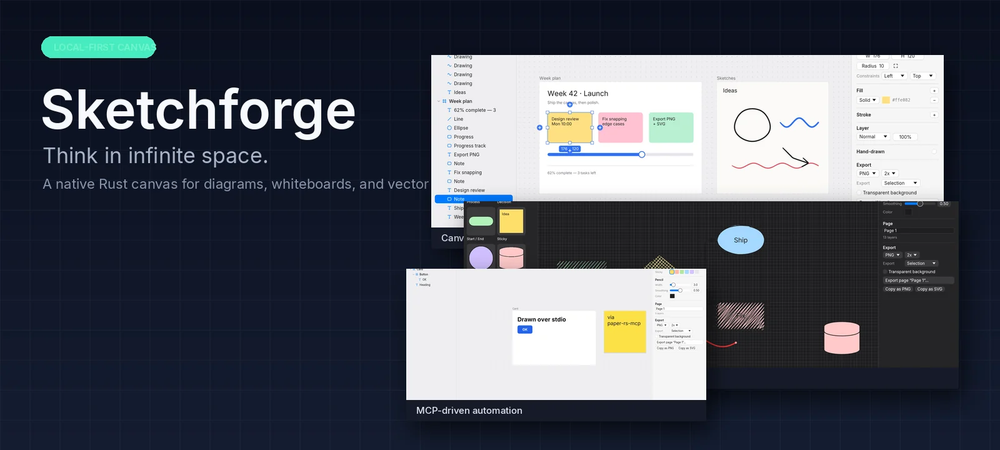

# Sketchforge



[](https://www.rust-lang.org)
[](LICENSE)
[](#build-and-run)

Sketchforge is a local-first infinite canvas for diagrams, whiteboards and vector sketches. It runs as a native Rust app on `wgpu`, `winit` and `egui`. Projects live in plain folders on your disk. Nothing needs an account, a cloud service or a browser tab.

It is also a vibe-coded project. Most of the implementation was written by AI agents from prompts, then built, tested and corrected in this repo. That is part of its history, not a marketing line. If you want a hand-designed, stable product, this is not it yet. If you want a fast canvas you can inspect, fork and push further, you are in the right place.

## What you can do

- Draw frames, shapes, paths and text on an infinite canvas.
- Edit vectors with booleans, corners and snapping.
- Connect shapes with arrows that re-route when you move things.
- Switch to whiteboard mode for rough shapes, sticky notes, a laser pointer and a shape library.
- Work across pages and projects, with undo and redo for each page.
- Import SVG and Excalidraw files. Import and export draw.io diagrams.
- Export PNG, SVG and PDF, including frame exports at 1x or 2x.
- Drive the running app from an MCP client to create shapes, edit styles and export files.


## Why it exists

Sketchforge grew out of a clean-room study of Paper Desktop. `analysis/PAPER_ARCHITECTURE.md` records what that app does, based on a licensed copy. No Paper code, shaders, icons, fonts or assets are in this repo. Sketchforge is not affiliated with or endorsed by Paper.

The old app name was Sketch, and before that paper-rs. The file format and environment variables still accept the old names.

## Quick start

You need Rust 1.95 or newer. Install it with [rustup](https://rustup.rs).

```sh
cargo build --release
./target/release/sketch-rs                  # projects home screen
./target/release/sketch-rs --demo           # sample board, not saved
./target/release/sketch-rs ~/Documents/sketch-rs/Plan   # open a project
./target/release/sketch-rs board.sketch-rs  # open a Sketch document
```

On macOS the release build uses Metal. On Linux it uses Vulkan through wgpu. Shortcuts use `Cmd` on macOS and `Ctrl` elsewhere.

### Optional MCP bridge

Build `sketch-rs-mcp` with the main binary and point an MCP client at it. The bridge talks to the running app over localhost and exposes tools for selection, creation, styling, export and project navigation.

```sh
cargo build --release --bin sketch-rs-mcp
```

The app listens on `SKETCH_RS_MCP_PORT` when that variable is set. See `src/mcp/tools.rs` for the current tool list.

## Where your files go

Each project is a folder.

```text
~/Documents/sketch-rs/<project>/
  project.json
  pages/
    650eff920501e1d1.json
```

Pages are JSON files. They are versioned and migrate on load. Autosave writes through a temporary file and renames it into place, so a crash should not leave a half-written page. Set `SKETCH_RS_HOME` to put projects somewhere else.

Sketchforge moves `~/Documents/paper-rs` to `~/Documents/sketch-rs` on first launch. It still opens `.paper-rs` documents and the old `PAPER_RS_*` environment variables.

## Controls

The app shows a shortcut sheet from the help menu. The ones people use first:

| Action | macOS | Linux |
| --- | --- | --- |
| Select | `V` | `V` |
| Hand / pan | `H` or space drag | `H` or space drag |
| Rectangle | `R` | `R` |
| Ellipse | `O` | `O` |
| Text | `T` | `T` |
| Connector | `C` | `C` |
| Sticky note | `S` | `S` |
| Duplicate | `Cmd D` | `Ctrl D` |
| Delete | `Delete` | `Delete` |
| Undo / redo | `Cmd Z` / `Cmd Shift Z` | `Ctrl Z` / `Ctrl Shift Z` |
| Zoom to fit | `Shift 1` | `Shift 1` |

Trackpad pinch zooms on macOS. Middle drag and space drag pan everywhere.

## Repo layout

```text
src/app.rs              winit loop and window setup
src/editor/             tools, input, history, pages, commands
src/model/              nodes, styles, paint, layers, document settings
src/render/             wgpu scene, tessellation, draw ops, rough strokes
src/io/                 project files, SVG/PDF/PNG, Excalidraw and draw.io
src/ui/                 sidebar, inspector, palette, find and templates
src/mcp/                tools, HTML/CSS mapping, localhost server
tests/                  headless render, import/export, MCP and theme checks
docs/screenshots/       images produced by cargo test
docs/assets/            README artwork
site/                   static download page, see site/README.md
scripts/                release and README art generators
AGENTS.md               workflow for coding agents
```

## Checks

```sh
cargo fmt --check
cargo clippy --all-targets -- -D warnings
SKETCH_RS_REQUIRE_GPU=1 cargo test -- --skip m2_pages_panel_screenshot
cargo build --release
git diff --check
```

The GPU-backed tests draw real frames. On a machine without a usable adapter, most of them return early. `m2_pages_panel_screenshot` is currently flaky in headless Linux runs and is skipped in the command above.

The site has its own checks:

```sh
cd site
npm run check
npm run build
```

## Known gaps

This is a working app, not a finished clone. Collaboration, cloud stencils and AI generation are not implemented. Some draw.io styles are imported as approximations. HTML and PDF export cover documents but not every browser-specific detail. The README screenshots are regenerated by tests, so a GPU change can make them differ from the committed files.

## Contributing

Issues and patches are welcome. Keep changes local-first, avoid adding analytics or network calls, and run the checks above. Generated images under `docs/screenshots/` should only change when the change is meant to update them. Generated evidence belongs under the ignored `.artifacts/` folder.

## License

Sketchforge code is MIT licensed. See [LICENSE](LICENSE).

Inter Regular, Medium and SemiBold are copyright the Inter Project Authors and licensed under the SIL Open Font License 1.1. See `assets/fonts/OFL.txt`. Agent skills under `.agents/skills/` keep their own licenses, listed in `THIRD_PARTY.md`.
